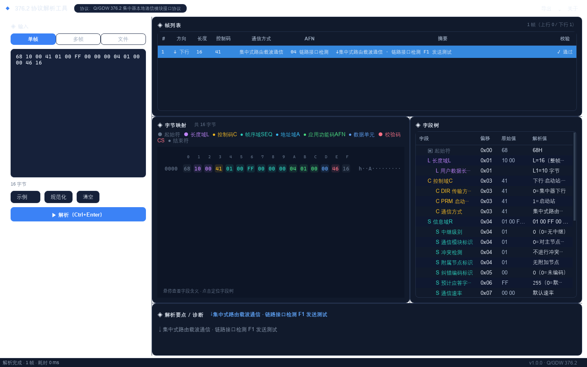

# 376.2 协议解析工具

面向 **Q/GDW 376.2《电力用户用电信息采集系统通信协议 第2部分：集中器本地通信模块接口协议》** 的报文解析桌面工具。



## 功能特性

- **单帧解析**：粘贴一帧 hex（自动忽略空格/换行/注释/时间戳），逐字段拆解链路层与应用层；
- **多帧解析**：连续字节流自动分帧（含噪声重同步、粘包拆分），帧列表逐帧浏览；
- **文件提取**：从 `.txt/.log/.csv/.hex` 文本日志及 `.bin` 二进制文件中自动提取帧并解析（支持带时间戳/中文注释的抓包日志）；
- **字节映射图**：按字段语义着色（起始符/长度/控制码/地址/AFN/SEQ/数据/CS/结束符），悬停查看含义，点击定位字段树；
- **字段树**：字段名 / 偏移 / 原始值 / 解析值 三级展示，控制码 bit 位、应用层数据单元逐项解读；
- **校验诊断**：长度域一致性、CS 累加和校验，失败帧给出具体原因与偏移；
- **内嵌 645**：中继类报文中 DL/T 645-2007 报文的识别与结构解析；
- **导出**：JSON / TXT 解析报告、一键复制解析文本；
- **示例帧库**：内置典型样例（链路检测、中继抄读、中继数据、广播对时等）。

## 快速开始

### 方式一：可执行文件（免安装）

双击 `dist/376.2协议解析工具/376.2协议解析工具.exe`。

### 方式二：源码运行

```bash
# 依赖 Python 3.10+（本机 D:/workspace/devEnvironment/python）
pip install PySide6-Essentials
python src/main.py
```

### 自测

```bash
python src/main.py --selftest
```

## 打包

```bash
scripts\build_exe.bat
```

## 项目结构

```
AnalysisTool/
├── docs/            设计文档（需求/总体/协议/UI/测试/发布）
├── resources/       协议调研笔记（含来源与已验证示例帧）
├── src/
│   ├── qgdw3762/    协议引擎（扫描/解析/字典/内嵌645，纯Python无GUI依赖）
│   ├── app_svc/     解析管线与导出服务
│   ├── gui/         PySide6 界面（主题/输入面板/字节映射图/字段树/主窗口）
│   └── main.py      入口（GUI / --selftest）
├── tests/           pytest 单元测试
├── samples/         样例报文文件
└── scripts/         打包脚本
```

## 文档索引

| 文档 | 内容 |
|---|---|
| [01-需求分析说明书](docs/01-需求分析说明书.md) | 功能/非功能需求、验收标准 |
| [02-总体设计说明书](docs/02-总体设计说明书.md) | 架构、模块、数据流、API |
| [03-协议解析设计说明书](docs/03-协议解析设计说明书.md) | 376.2 帧格式与解析算法 |
| [04-UI设计说明书](docs/04-UI设计说明书.md) | 设计语言、布局、交互规格 |
| [05-测试报告](docs/05-测试报告.md) | 测试用例与结果 |
| [06-构建与发布说明](docs/06-构建与发布说明.md) | 打包步骤与运行验证 |

## 协议依据

协议格式依据 `resources/research/` 下的调研笔记（多来源交叉验证，关键事实附来源链接；示例帧均通过 CS 校验自洽性验证）。
